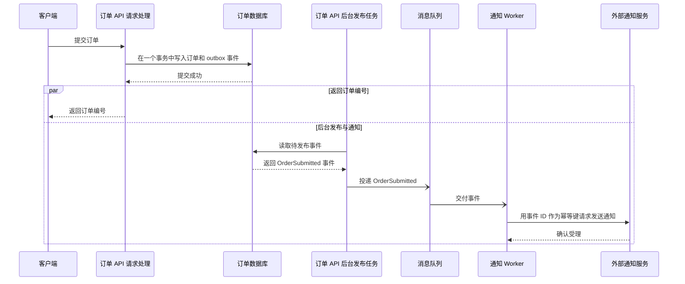

# 4+1 视图怎么画

4+1 是 Philippe Kruchten 提出的软件架构描述模型。逻辑、开发、进程、物理四个视图分别解释业务功能、代码组织、运行协作和部署拓扑。场景视图是「+1」，用关键用例找出系统需要的架构元素，并验证这些元素能否协同工作。一个视图可以用多张图和文字说明来表达，按系统的复杂度和评审重点选图。本文给出的 UML 图型是实际绘图时的选型建议。[Kruchten 原文](https://arxiv.org/abs/2006.04975)

## 用什么软件

| 工具 | 适用情况 | 操作方式 |
| --- | --- | --- |
| PlantUML | 团队用 Git 维护 UML，希望在代码评审中查看改动 | 新建 `.puml`，在 VS Code 安装 PlantUML 扩展并按 `Alt+D` 预览。也可用 PlantUML 命令行生成 SVG，再从 Markdown 用相对路径引用。[PlantUML 官方文档](https://plantuml.com/)、[VS Code 扩展](https://marketplace.visualstudio.com/items?itemName=jebbs.plantuml) |
| draw.io（diagrams.net） | 希望用鼠标拖拽绘图，或需要手动调整布局 | 新建图，在左侧「更多图形」启用 UML 2.5 图形库，保存 `.drawio` 源文件，需要展示时导出 SVG 或 PNG。[UML 图形库](https://www.drawio.com/blog/uml-2-5/)、[导出格式](https://www.drawio.com/docs/manual/export/export-diagram/) |
| Mermaid | 希望把简单的图直接写在 GitHub Markdown 里 | 用 `mermaid` 代码块画时序图、类图或方框拓扑。需要标准 UML 用例或部署符号时，选 PlantUML 或 draw.io。[GitHub 绘图文档](https://docs.github.com/en/get-started/writing-on-github/working-with-advanced-formatting/creating-diagrams)、[Mermaid 图型文档](https://mermaid.js.org/intro/) |

团队长期维护时可优先考虑 PlantUML，初学或讨论时可先用 draw.io。交付时保留 `.puml`、`.drawio` 或 Markdown 中的 Mermaid 源码，方便后续更新。

## 各视图画什么

| 视图 | 回答的问题 | 建议先画 | 需要更多细节时补画 |
| --- | --- | --- | --- |
| 逻辑视图（Logical） | 系统提供什么能力，关键业务对象如何关联？ | 领域类图或逻辑模块图 | 关键对象状态机图 |
| 开发视图（Development / Implementation） | 源码如何组织，模块如何依赖和构建？ | 包图或组件图 | 产物与源码模块的映射表 |
| 进程视图（Process） | 系统运行时，哪些执行单元如何通信和并发？ | 运行单元及通信图 | 关键时序图、带泳道的活动图 |
| 物理视图（Physical / Deployment） | 运行单元部署到哪里，节点如何连通？ | UML 部署图 | 不同环境的部署图、故障切换图 |
| 场景视图（Scenarios / Use Cases） | 谁用系统做什么，关键场景能否贯穿四个视图？ | 用例图和关键场景说明 | 场景时序图或活动图 |

以下用同一个「提交订单并异步通知」场景演示各图的画法。

### 1. 逻辑视图

- **领域类图**。找出核心实体、值对象和关键接口，画出有业务含义的关联、组合和多重性。按需标注决定规则的属性或操作。例如 `Order` 包含 `1..*` 个 `OrderItem`，`Order` 负责维护自身状态。
- **逻辑模块图**。系统较复杂时，先划分业务能力，再写每个能力的职责、对外接口和协作方向。例如订单管理负责记录订单，通知负责向客户发送确认消息。
- **状态机图（按需）**。如果生命周期本身是设计重点，画状态、触发事件、守卫条件和允许的迁移，例如订单从「已提交」进入「已取消」的条件。
- **注意事项**。使用统一的业务词汇。类图只保留能解释业务规则或架构边界的元素。模块图的箭头应说明代表业务依赖、调用还是事件订阅。

### 2. 开发视图

- **包图**。以真实仓库、目录、包或工程为依据，按层或业务域分组，标出依赖方向。例如 `order-app` 依赖 `order-domain`，`order-infra` 实现应用层声明的持久化接口。
- **组件图**。需要解释构建和发布时，画主要构建模块、其提供或依赖的接口，以及生成的产物。例如 `order-api` 组装订单应用与基础设施模块并构建 `order-api` 镜像，`notification-worker` 构建独立的镜像。
- **注意事项**。依赖箭头从使用方指向被依赖方，并在图例说明静态依赖的含义。用仓库路径或构建文件核实名称、依赖和产物，检查跨层依赖与循环依赖。运行时通信放到进程视图详述。

### 3. 进程视图

- **运行单元及通信图**。先画服务进程、工作进程和影响并发的线程或任务，再连上同步调用、异步消息、存储访问等关键通道。例如订单 API 有请求处理和后台发布任务，消息队列把订单事件交给通知 Worker。
- **时序图**。生命线用实际执行单元或外部参与者，按时间顺序标注关键调用、事务边界和消息。用 `alt` 标异常分支，`loop` 标重试，`par` 标影响行为的并发路径。
- **带泳道的活动图（按需）**。当分支、并行和汇合较多时，以进程或任务为泳道，画动作、条件、分叉与汇合，标清由谁执行每一步。
- **注意事项**。给同步和异步箭头明确的标签，标出超时、重试、幂等或故障恢复由谁负责。需要验证性能时，标出与设计相关的吞吐、延时或并发目标。

这张 `UC-01` 成功路径时序图展示了请求响应与后台通知的边界。`outbox` 是待发布事件表，新增订单和插入事件在同一个事务中完成。事务提交后，返回订单编号和后台发布可以并行执行。[Mermaid 时序图语法](https://mermaid.js.org/syntax/sequenceDiagram.html)

### 4. 物理视图

- **部署图**。先标环境和网络边界，再画虚拟机、容器集群、入口网关、托管数据库、消息队列等节点或服务。在节点内标注部署产物及关键副本数，在线上标注协议、方向和必要的端口。
- **示例**。生产环境的客户端经 HTTPS 到入口网关。应用集群运行 2 个订单 API 副本与 2 个通知 Worker 副本。API 访问托管订单数据库及消息队列，Worker 消费队列并经 HTTPS 访问外部通知服务。
- **注意事项**。明确是当前部署还是目标部署。不同环境的拓扑有实质差异时分图。跨网络区的连线写明通信方式。涉及副本、故障切换或隔离时，标清适用范围，并用部署配置核对节点、产物和连接关系。

### 5. 场景视图（+1）

- **用例图**。画系统边界，外侧放用户角色和参与的外部系统，边界内放以动宾短语命名的用例。连出谁发起、谁参与。例如「顾客」关联「提交订单」，「外部通知服务」关联「发送订单通知」。用例间的先后关系用时序图或文字表达。
- **关键场景说明**。为关键用例选出能影响架构的成功路径和异常路径，写明编号、参与者、前置条件、触发、主流程、异常流程和最终状态。复杂交互可以补一张场景时序图，也可引用已有的进程时序图并标明关联的场景编号。
- **示例**。在 `UC-01 提交订单` 中，已登录的顾客提交订单。系统校验订单、保存订单及待发布事件，随后返回订单编号并异步发送通知。事务失败时返回下单失败。外部通知服务支持幂等键，通知请求失败时订单保持已提交，Worker 使用同一事件 ID 重试。
- **注意事项**。优先选关键业务、异常恢复和性能敏感的场景。走查每一步由哪个业务对象或模块负责、在哪个运行单元执行、部署在哪个节点。用例图提供范围，具体路径用文字或交互图验证。

## 实际绘图顺序

1. **确定系统边界和场景**。列出用户角色、外部依赖和关键需求，先选少量具代表性或高风险的场景。
2. **画逻辑视图与开发视图**。沿场景找业务对象和职责，再依据源码或目标设计找到实现它们的包、组件与构建产物。
3. **画进程视图与物理视图**。把产物落实到运行单元及通信通道，再把运行单元映射到部署节点和环境。
4. **回到场景走查**。验证正常、失败和恢复路径，补图或修正相互矛盾的名称、边界和依赖。用下面的表记录关键步骤在各视图里的对应关系。

| 场景与步骤 | 逻辑对象或能力 | 开发模块或产物 | 运行单元 | 部署位置 |
| --- | --- | --- | --- | --- |
| `UC-01` 保存订单并返回编号 | `Order`、订单管理 | `order-domain`、`order-app` → `order-api` 镜像 | 订单 API 请求处理 | 生产应用集群的订单 API 实例 |
| `UC-01` 发送订单确认通知 | 通知 | `notification-worker` → 同名镜像 | 通知 Worker 消费事件并调用外部服务 | 生产应用集群的 Worker 实例 |

## 交付前检查

- 每张图有标题、范围和必要的图例。方框的含义、箭头方向及缩写能从图或图注读懂。
- 图内元素的粒度一致。信息过多时拆成总览图和局部图，并在总览中指向局部图。
- 跨视图用相同的名称或显式映射。业务能力能找到代码实现，部署产物能找到运行位置，关键调用能在拓扑中找到可达路径。
- 评审至少走查一条成功路径及相关异常路径。图和源码、运行配置或目标设计保持一致。
